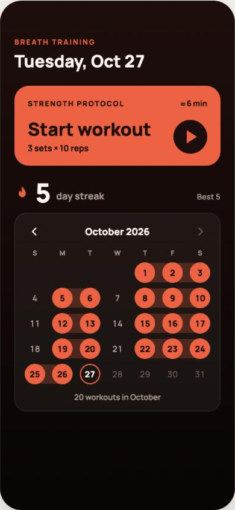
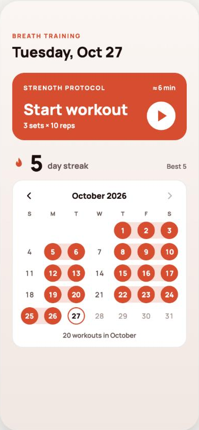
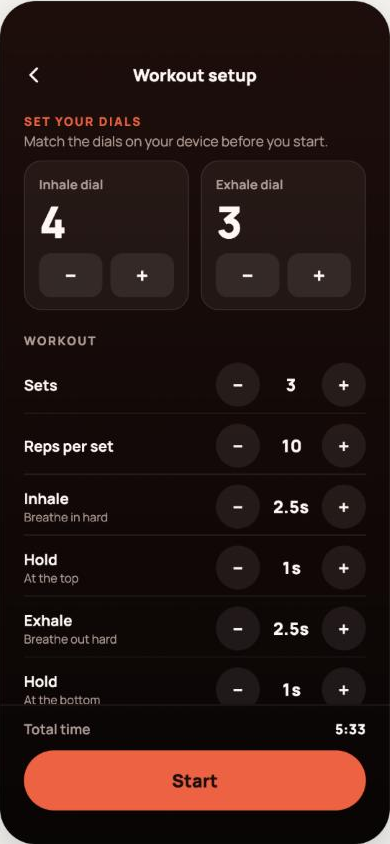
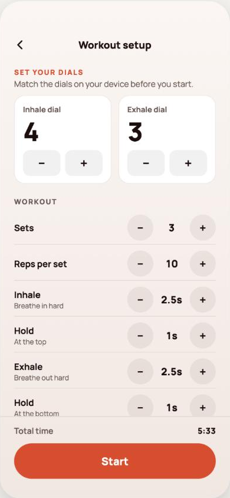
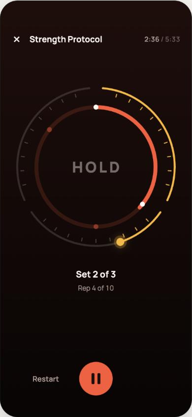
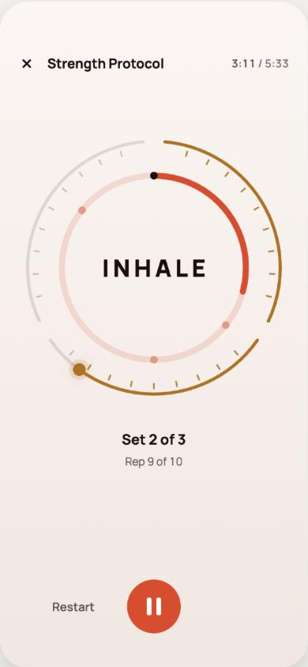
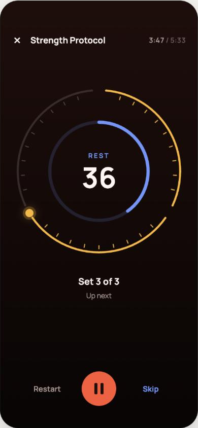
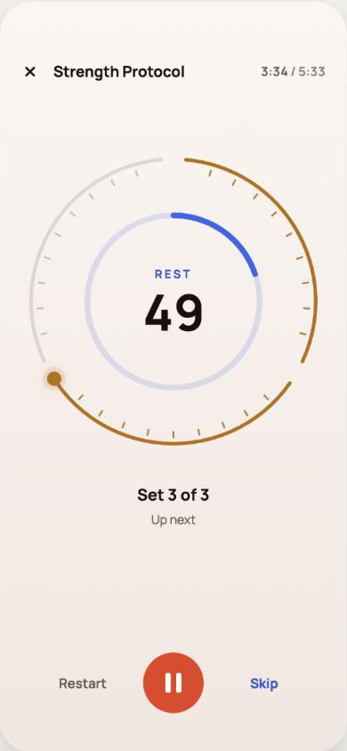
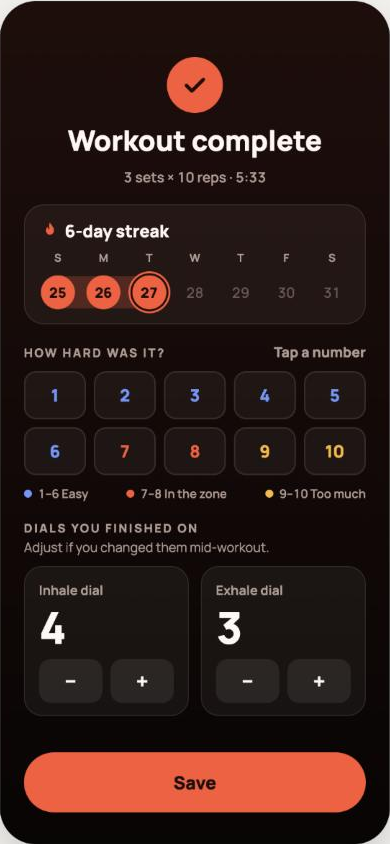
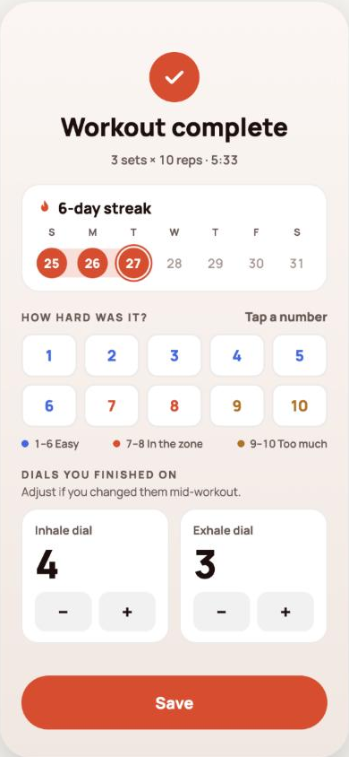

# Heat screens

Captured on 2026-10-27 from the "Heat · every screen, dark + light" board of the design canvas. Each image is 390×844, the design size.

| Screen | Dark | Light |
|---|---|---|
| Home |  |  |
| Setup |  |  |
| Session, breathing |  |  |
| Session, rest |  |  |
| Complete |  |  |

Notes:

- These are visual references. Where they differ from `SPEC.md` or `docs/PLAN.md`, follow those documents. For example, the effort grid here allows Save with no rating, but the plan makes a rating required.
- The calendar and streak use the prototype's made-up history.
- Not captured: the "Done for today" Home card, the lead-in "GET READY" countdown and the "Done" session state. Build those from the spec.
